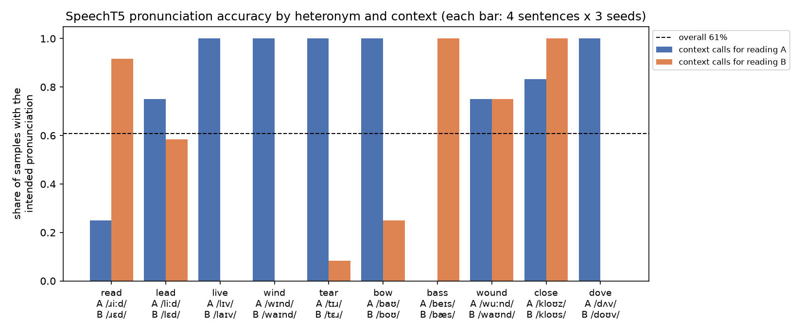

# How a TTS model turns context into pronunciation

[](https://colab.research.google.com/github/Shantanu-Das/context-dependent-tts-analysis/blob/main/project.ipynb)
<!-- Replace YOUR-USERNAME/YOUR-REPO with the GitHub repository path once it exists. -->

A small empirical study of a pretrained text-to-speech model.

## Research question

When a TTS model reads a **heteronym** (one spelling, two pronunciations, as in *I **read** the book every day* /ɹiːd/ vs *I **read** the book yesterday* /ɹɛd/), does the surrounding context make it produce the intended pronunciation? And can the intended pronunciation be decoded from the model's internal text representations?

## Model and dataset

- **TTS model:** [`microsoft/speecht5_tts`](https://huggingface.co/microsoft/speecht5_tts) with the [`speecht5_hifigan`](https://huggingface.co/microsoft/speecht5_hifigan) vocoder (both MIT) and the CMU ARCTIC `slt` speaker x-vector.
  - **Why this model:** SpeechT5 reads **raw characters** and has no grapheme-to-phoneme front-end, so the neural network itself must resolve the heteronym. Many TTS systems (Kokoro, Piper/Coqui VITS) phonemize text first, which would make the question untestable.
  - **Architecture:** a 12-layer bidirectional Transformer text encoder (which we probe) and an autoregressive mel-spectrogram decoder.
- **Evaluator:** [`facebook/wav2vec2-lv-60-espeak-cv-ft`](https://huggingface.co/facebook/wav2vec2-lv-60-espeak-cv-ft), a phoneme recogniser that outputs IPA rather than words, plus torchaudio's `MMS_FA` forced aligner to locate the target word.
- **Dataset:** 40 hand-written sentence pairs (80 sentences). There are 10 heteronyms (*read, lead, live, wind, tear, bow, bass, wound, close, dove*) with 4 pairs each. Both sentences of a pair use the same spelling in contexts that call for different readings, and the reference pronunciations come from CMUdict. 16 unambiguous control words validate the evaluator. Every sentence is generated with 3 fixed seeds (288 clips).

## Main findings

| | Result |
|---|---|
| Evaluator accuracy on control words | 48/48 (100%) |
| Intended pronunciation produced (samples) | 146/240 = **60.8%** |
| Intended pronunciation produced (sentences, majority of 3 seeds) | 49/80 = 61% (95% CI 50–71%) |
| Pairs where the pronunciation switches correctly with context | **9/40** |
| Pairs with the same pronunciation in both contexts | **24/40** (0 reversed, 7 unclear/split) |
| Probe accuracy, encoder layer 0 → layer 12 | 59% → **74%** (McNemar vs layer 0: p ≈ 0.04) |

- **H1, weakly supported.** SpeechT5 does somewhat better than a context-blind model (50%), but mostly it uses a **fixed default reading per word**. *wind* is always /wɪnd/, *dove* always /dʌv/, *bass* always /bæs/, and *read* is nearly always /ɹɛd/.
- **H2, supported.** Context sensitivity varies sharply between words. *close* (/kloʊz/ vs /kloʊs/) follows context well, *wound* and *lead* partly, and *wind*, *bass* and *dove* not at all.
- **H3, weakly supported.** The intended reading becomes increasingly **linearly decodable** in later encoder layers, even in many sentences the model mispronounced. The context information reaches the encoder, but the spoken output often ignores it. This is decodability, not proof of mechanism.



## Methodology

1. **Feasibility.**
   - Confirmed the tokenizer passes raw characters to the model.
   - Confirmed the audio is finite and reproducible per seed.
   - Confirmed the model's decoder is stochastic (pre-net dropout stays on at inference), hence 3 seeds per sentence.
   - Checked that the evaluator can tell the relevant contrasts apart.
2. **Generation.** One model, one voice, `generate_speech` defaults, seeds 0/1/2, all on CPU.
3. **Evaluation.**
   - Recognise the phonemes of the whole sentence.
   - Take the phonemes inside the force-aligned time window of the target word.
   - Pick whichever reference pronunciation is closer by edit distance. Ties are `unclear` and count as wrong.
   - The evaluator was validated on unambiguous control words before use.
4. **Comparison.** Within each word, compare the two contexts using the per-word *context effect*, P(reading A | context A) − P(reading A | context B), and classify each pair's outcome.
5. **Probing.**
   - Mean encoder hidden state over the target word's characters, at each of 13 layers.
   - A nearest-centroid probe per heteronym, with leave-one-pair-out splits (a pair is never split between train and test).
   - No hyperparameters, all layers reported. Layer 0 (non-contextual) is the baseline.

## Limitations

- Labels come from an automatic phoneme recogniser that was validated on controls, not from human listening. Listening to the failure cases in the notebook is the most useful next check.
- The dataset is small and hand-written (10 words × 4 pairs). Some pairs differ in syntax as well as in the cue word.
- One model, one voice, 3 seeds. Seeds of one sentence are correlated.
- The probe uses tiny training sets, its labels are confounded with context words, and layer 0 carries a position confound. Decodability does not mean the decoder *uses* the information.
- The reason for each word's default reading (e.g. frequency in the training data) is a hypothesis that was not tested.
- No-context (single-word) inputs were tried and dropped, because SpeechT5 produces unreliable speech for them.

## Reproduce

Tested locally on Windows 11, Python 3.12, CPU only. A full run takes roughly 15 minutes and downloads about 3 GB of model weights.

```bash
python -m venv .venv
.venv/Scripts/pip install -r requirements.txt   # Linux/macOS: .venv/bin/pip
.venv/Scripts/jupyter nbconvert --to notebook --execute --inplace project.ipynb
```

Or open `project.ipynb` in Jupyter and run all cells. Generated audio is cached in `audio_cache/` (git-ignored) and reused on later runs; the notebook prints how many clips were cached versus newly generated. Colab has not been tested. To try it there: clone the repository, `cd` into it, and `pip install -r requirements.txt` before running. The pinned `torch` version may reinstall PyTorch.